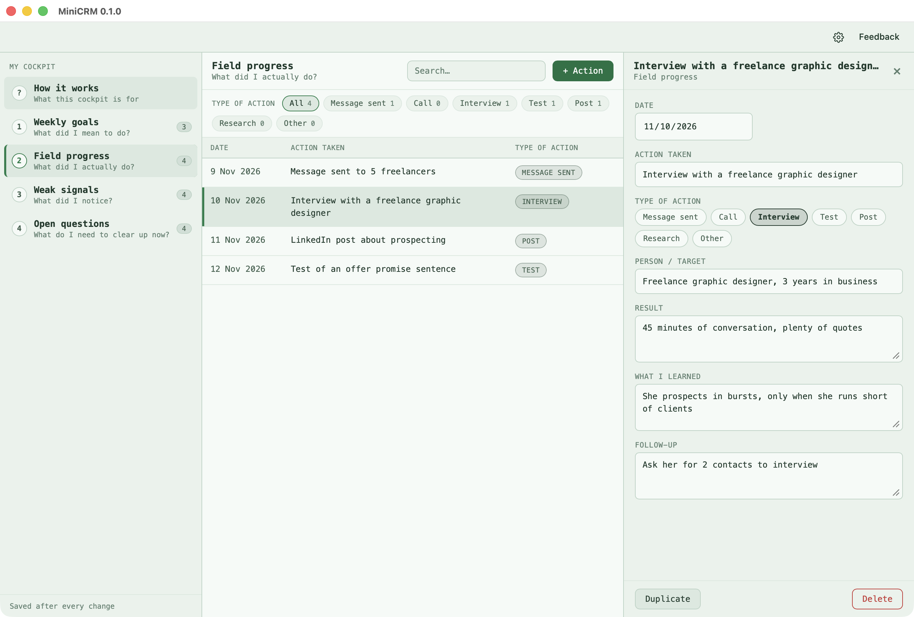

# MiniCRM

A weekly cockpit for someone starting a business. It answers four questions
each week, one table each, and nothing more: no indicators, no automation, no
connection to other tools.

| Page | The question it answers |
| --- | --- |
| Weekly goals | What did I mean to do? |
| Field progress | What did I actually do? |
| Weak signals | What did I notice? |
| Open questions | What do I need to clear up now? |

**How it works**, the page it opens on, explains the routine in four steps and
counts the priorities that are done, under way and blocked.



A new cockpit opens with example lines from a made-up project (a coaching offer
that helps freelancers organise their prospecting), dated in the current week.

## Using it

- Pick a page on the left; **+ Goal** (or Action, Signal, Question) adds a
  line and opens it in the editor on the right.
- Statuses and other lists are one click in the editor, and coloured in the
  table: neutral for *To do*, blue for *In progress*, green for *Done*, red for
  *Blocked*.
- Filter a table by its list column with the chips above it, search every
  column with the box, and sort by clicking a column heading.
- Everything is saved as you type, to `cockpit.json` in the app's data folder
  (Settings shows the file). Copying that file duplicates the cockpit.

## Building

MiniCRM is a [Dioxus](https://dioxuslabs.com) desktop app and sits beside
`desktop-kit`, which it takes the header, Settings, the update check and the
notice from, like the other mayorana desktop apps.

```bash
cargo run
```

```bash
cargo test
```

The design is GitAgent's: the same palette, type and layout, in
`assets/main.css`.
