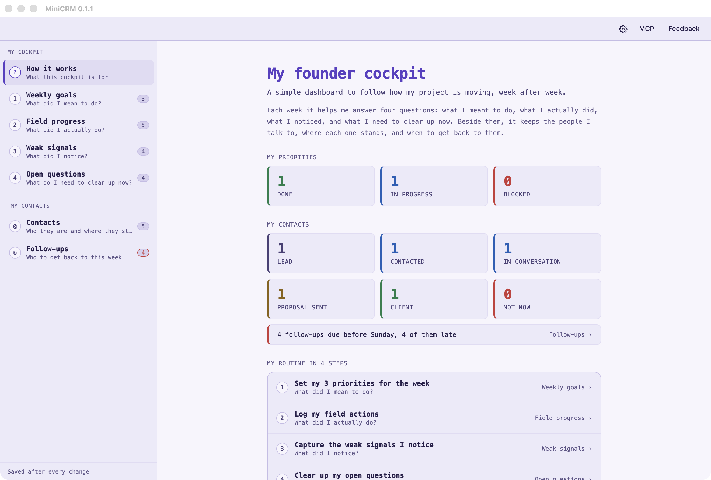

# MiniCRM

A weekly cockpit for someone starting a business and promoting it on their
own. It answers four questions each week, one table each, and keeps the people
the work is done with. It sits beside PolishCast, TrackCut and PublishKit,
which make and publish the content: what goes out shows up here, so the week's
review has the content and the people it reached in one place.

| Page | The question it answers |
| --- | --- |
| Weekly goals | What did I mean to do? |
| Field progress | What did I actually do? |
| Weak signals | What did I notice? |
| Open questions | What do I need to clear up now? |

Beside them:

| Page | What it keeps |
| --- | --- |
| Contacts | Who each person is, where I found them, and their stage, from *Lead* to *Client* |
| Follow-ups | Every contact and action whose follow-up date is this week or past, the late ones first |

**How it works**, the page it opens on, explains the routine in four steps,
counts the priorities that are done, under way and blocked, the contacts at
each stage, and the follow-ups due before Sunday.



A new cockpit opens with example lines from a made-up project (a coaching offer
that helps freelancers organise their prospecting), dated in the current week.

## Using it

- Pick a page on the left; **+ Goal** (or Action, Signal, Question) adds a
  line and opens it in the editor on the right.
- Statuses and other lists are one click in the editor, and coloured in the
  table: neutral for *To do*, blue for *In progress*, green for *Done*, red for
  *Blocked*.
- Filter a table by its list column with the chips above it, search every
  column with the box, and sort by clicking a column heading.
- A line of Field progress names its contact; a contact's editor lists what
  was done with them and logs the next action.
- A post published from PublishKit is logged in Field progress on its own, on
  the day it went out, once. Its **Video or post** field points at it; any
  action or weekly goal can point at a video or post from the media library
  the apps share, and open it in the app that made it. A goal can name one
  that is only planned, and follows it once it is made.
- Any line can carry files (**+ Attach files**, or drop them on its editor).
  They are kept by path, not copied, and open in their usual app; one moved
  or deleted since shows as **Missing**.
- **Import CSV** adds lines from a spreadsheet, Notion or LinkedIn's
  connections export, matching the file's headings to the table's columns.
  **Export CSV** saves a table, one column per column, contacts by name.
- Everything is saved as you type, to `cockpit.json` in the app's data folder
  (Settings shows the file). Copying that file duplicates the cockpit.

## From Claude or Codex

`minicrm mcp` serves the cockpit to an MCP client over stdio, with no window.
The **MCP** button at the top of the window installs it in Claude Desktop,
Claude Code, Codex and VS Code, shows where it is installed and running, and
tests it. Its tools:

| Tool | What it does |
| --- | --- |
| `overview` | This week's priorities, contacts per stage, follow-ups due, this week's videos and posts, and every table's columns |
| `list_lines`, `get_line` | A table's lines, filtered by stage, status or type, contact or text; a contact with what was done with them |
| `add_line`, `update_line`, `delete_line` | Change any table, contacts by name, lists checked against their values |
| `follow_ups`, `set_follow_up` | Who to get back to by Sunday (or within N days); set, push back or clear a follow-up |
| `import_csv`, `export_csv` | A table in from a CSV file (LinkedIn's export included) or out to one |

Each call reads `cockpit.json`, logs any post that went out since, changes it,
and writes it back; an open window notices the change and shows it. The media
library's own tools (`list_media`, `calendar`, `plan_media`) are PolishCast's,
TrackCut's and PublishKit's: MiniCRM reads the library but doesn't serve them
a second time.

## Building

MiniCRM is a [Dioxus](https://dioxuslabs.com) desktop app and sits beside
`desktop-kit`, which it takes the header, Settings, the update check and the
notice from, like the other mayorana desktop apps.

```bash
cargo run
```

```bash
cargo test
```

The design is GitAgent's: the same palette, type and layout, in
`assets/main.css`.
